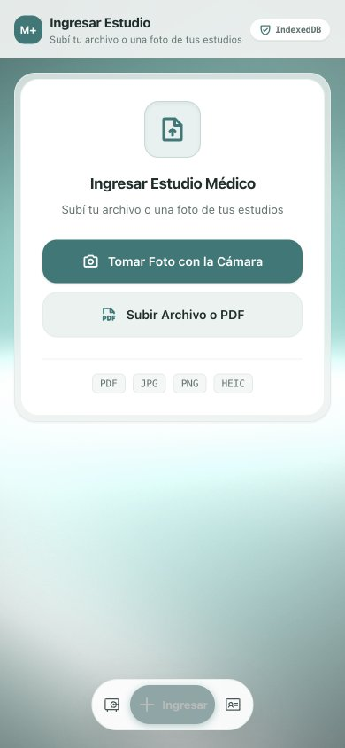

# MiSalud

Prototipo de PWA para guardar tus estudios médicos (laboratorios, recetas, imágenes) en el celular y encontrarlos rápido cuando un médico te los pide.



## Qué hace

- **Bóveda de estudios** con búsqueda y filtros por tipo.
- **Carga de PDFs e imágenes** y lector de PDF dentro de la app (PDF.js sobre canvas).
- **Perfil** del paciente editable.
- **Todo queda en el dispositivo:** los datos se guardan en IndexedDB, sin servidor.

## Stack

Vite 6 · React 19 · TypeScript · Tailwind 4 · IndexedDB (`idb`) · PDF.js · Framer Motion

## Cómo correrlo

```bash
npm install
npm run dev
npm run build   # chequeo de tipos + build
```

## Licencia

[MIT](LICENSE)
